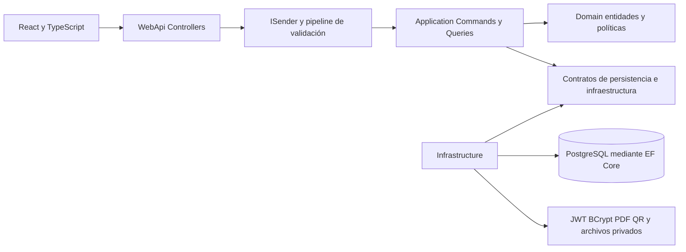

# Arquitectura de ForensicEdu con MediatR

La API conserva sus rutas y contratos JSON y delega los 83 casos de uso a comandos y consultas de Application mediante ISender.Send. La estructura toma como referencia Event.Service y mantiene PostgreSQL como único proveedor de ejecución.



## Capas y decisiones

- Domain contiene entidades y las políticas académicas. User.RenewFromApprovedPayment concentra la renovación de cuenta. No depende de EF Core, MediatR ni HTTP.
- Application contiene Contracts, Handlers por funcionalidad, Commands y Queries, ValidationBehavior, ApplicationResult y los contratos de adaptadores. Los servicios de evaluación, antifraude y ciclo de vida siguen siendo reutilizables por los handlers y procesos internos.
- Infrastructure implementa ApplicationDbContext, JWT, BCrypt, clasificación de errores PostgreSQL, almacenamiento privado de vouchers, PDF y QR. También contiene los trabajadores de segundo plano.
- WebApi recibe HTTP, obtiene la identidad mediante ICurrentUser, envía solicitudes por MediatR y traduce los resultados de Application a HTTP. Conserva los atributos de autorización por rol. ApiExceptionHandler convierte errores de validación, concurrencia, unicidad y conectividad a respuestas uniformes sin exponer secretos.

Se conserva IApplicationDbContext como abstracción de persistencia, extendiendo IUnitOfWork. Application utiliza las extensiones de consulta de EF Core: esta es una dependencia explícita y elegida. No se agregaron repositorios genéricos que dupliquen DbContext ni Dapper sin una necesidad de consultas independiente. CQRS separa los casos de uso, con una sola base y un solo modelo de persistencia. Application no referencia ASP.NET Core ni Npgsql.

La aprobación prepara pago, matrícula, renovación y auditoría y los confirma mediante un solo SaveChanges; EF Core usa una transacción en PostgreSQL. No hay publicación a un broker ni correos externos en ese flujo, por lo que no se añadió un Outbox sin un consumidor real. Si se incorpora mensajería, se requiere persistir el mensaje en la misma transacción y entregar con reintentos e idempotencia.

## Ejemplo del recorrido

POST /api/orders/checkout llega a OrdersController, que envía OrdersCreateOrderAndSubmitPaymentCommand. ValidationBehavior ejecuta FluentValidation antes del handler. El handler valida identidad, precio vigente y duplicidad, prepara orden y evidencia y guarda mediante el contexto. ApplicationResult conserva la respuesta funcional y WebApi asigna el estado HTTP.

Las entradas de archivos se convierten a bytes en el controlador, con límite de tamaño. Application verifica la firma del formato y solicita el guardado a IVoucherStorage. Infrastructure guarda el archivo fuera de wwwroot, con nombre interno generado.

## PostgreSQL y compatibilidad

La aplicación requiere DatabaseProvider=PostgreSQL y ConnectionStrings__DefaultConnection mediante configuración local privada o variables de entorno. SQL Server y el proveedor InMemory se retiraron de Infrastructure; InMemory queda únicamente en proyectos de pruebas. No se ejecutaron migraciones, modificaciones de tablas ni escrituras en la base remota durante esta adaptación.

No cambian las columnas ni las relaciones existentes. Hangfire conserva el almacenamiento en memoria que tenía el proyecto; no es una cola durable. El frontend conserva las simulaciones indicadas en GUIA_PROYECTO.md: esta adaptación de arquitectura no conecta automáticamente todos sus procesos al backend.

## Modo claro y nocturno

ThemeProvider aplica los colores semánticos a todas las pantallas y modales. El botón de sol o luna de la cabecera cambia el tema. La preferencia se guarda en forensicedu-theme; sin preferencia se utiliza la del sistema. También se sincroniza entre pestañas. Un script inicial aplica el tema antes de renderizar React. Los diplomas imprimibles mantienen el papel blanco y el contraste del QR.

## Verificación

```powershell
dotnet build src/ForensicEdu.WebApi/ForensicEdu.WebApi.csproj
dotnet run --project tests/ForensicEdu.BusinessChecks
dotnet run --project tests/ForensicEdu.ArchitectureChecks
node tests/Test-ApiArchitecture.mjs
npm --prefix src/ForensicEdu.ClientApp run lint
```

ArchitectureChecks resuelve todos los handlers desde DI y prueba el pipeline, registro, login, restricción de órdenes ajenas, comprobación de precio, voucher, aprobación, matrícula, vigencia, configuración y cancelación. Las pruebas usan una base efímera en memoria y adaptadores de prueba para JWT, almacenamiento y PDF; no sustituyen pruebas de integración y concurrencia contra PostgreSQL.


Los 50 casos de uso añadidos y sus permisos están descritos en API_PRUEBAS.md. El esquema conserva las tablas originales CourseModule y CourseDocument.


## Responsabilidad única y segmentación

Cada uno de los 83 casos de uso tiene su request y su handler en archivos separados, conservando namespaces y rutas. Los 74 validadores existentes también tienen su propio archivo; una consulta sin entradas no necesita un validador vacío.

```text
Handlers/Management/CatalogAdmin/Commands/CreateCourse/
  CreateCourseCommand.cs
  CreateCourseCommandHandler.cs
  CreateCourseCommandValidator.cs
```

Los contratos, interfaces, entidades y enums se separan por tipo público. Los validadores de entradas se reutilizan mediante SetValidator, sin repetir las reglas de cada DTO en todos sus handlers.

Infrastructure.DependencyInjection compone tres registros: AddPostgreSqlPersistence, AddDatabaseResilience y AddPlatformAdapters. Application registra MediatR, validadores y servicios académicos. Los DbContext y adaptadores con estado de solicitud son scoped; el circuito y el clasificador de fallos son singleton. IApplicationDbContext e IUnitOfWork resuelven la misma instancia scoped.

ExpiredExamsWorker se ocupa de la programación y el ciclo de vida; IExpiredExamProcessor procesa las evaluaciones vencidas. Ambos reciben sus dependencias por constructor.

## Circuit breaker de PostgreSQL

Polly.Core 8.6.6 implementa el circuito en Infrastructure, detrás de IDatabaseResilience. Application solo conoce la interfaz y DatabaseCircuitOpenException; no depende de Polly ni de Npgsql.

El pipeline ejecuta ValidationBehavior antes de DatabaseResilienceBehavior. Un error de entrada se rechaza antes de consultar la dependencia. El mismo circuito protege la consulta de cuenta del JWT y los trabajos académicos de segundo plano. El bootstrap local y la comprobación de salud de desarrollo no pasan por el pipeline.

La configuración pública está en Resilience:PostgreSQL de appsettings.json:

```json
{
  "FailureRatio": 0.5,
  "MinimumThroughput": 5,
  "SamplingDurationSeconds": 30,
  "BreakDurationSeconds": 15
}
```

Con al menos cinco operaciones en una ventana de 30 segundos, una proporción de fallos transitorios del 50% abre el circuito por 15 segundos. Después admite una prueba; un éxito lo cierra y un fallo transitorio lo abre de nuevo. El estado es local al proceso, no distribuido entre réplicas. Se registran las transiciones sin imprimir credenciales ni datos bancarios.

NpgsqlTransientFailureClassifier cuenta exclusivamente excepciones Npgsql transitorias, incluidas las envueltas. Validaciones, unicidad, cancelaciones y errores de negocio no disparan el circuito. Un circuito abierto se traduce a HTTP 503 con Retry-After.

El circuito no reintenta el handler. Se retiró EnableRetryOnFailure para evitar repetir escrituras ante un commit ambiguo. Si una escritura pierde la confirmación, el cliente debe consultar su estado antes de repetirla. No se introduce un estado de éxito falso ni se sustituye PostgreSQL por almacenamiento en memoria cuando la dependencia falla.

## Comprobaciones de resiliencia

```powershell
dotnet run --project tests/ForensicEdu.ResilienceChecks
# Con API_TEST_DLL apuntando a la API compilada y PostgreSQL 17 instalado localmente:
node tests/Test-DatabaseCircuit.mjs
```

ResilienceChecks utiliza un reloj controlado para verificar apertura, rechazo inmediato, cancelación, half-open concurrente, recuperación, reapertura, clasificación, validación previa, opciones inválidas y tiempos de vida de DI. Además comprueba un tipo público por archivo y los archivos de cada request, handler y validador.

Test-DatabaseCircuit crea su propia instancia PostgreSQL local, consulta la API, detiene esa instancia para abrir el circuito y la reinicia para comprobar la recuperación. No utiliza la base de Contabo.

Los materiales privados tienen comandos/consultas separados bajo Handlers/Documents y puertos IDocumentStorage e IDocumentProcessor. RustFS y el procesamiento seguro de Word se implementan en Infrastructure/Documents. Ver DOCUMENTOS_PRIVADOS.md.
